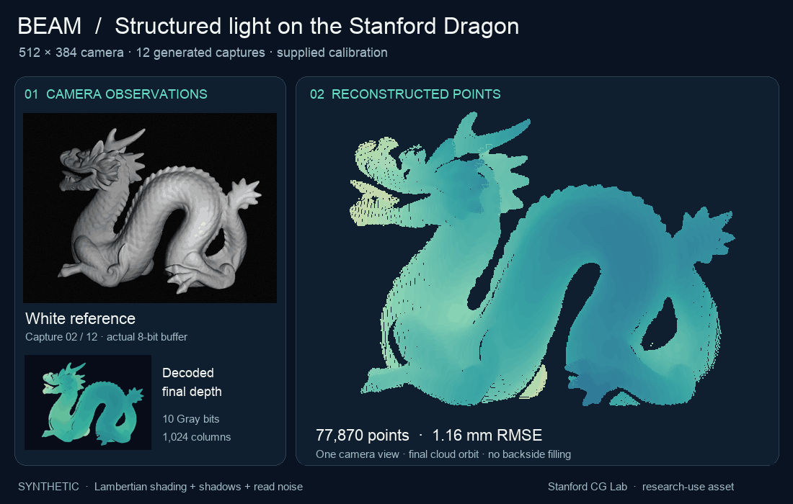
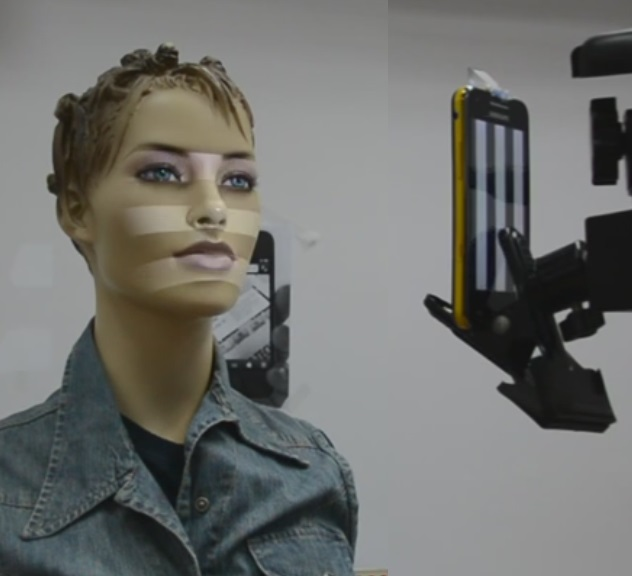

# 3D Scanner on Android

Turn a phone and projector into a structured-light 3D scanner. A **Samsung Galaxy Beam**, fitted with a right-angle reflecting prism, projects coded stripes into its camera’s field of view. Decoding those stripes identifies a projector coordinate for each camera pixel; calibrated triangulation recovers the surface.

Students: Arkadi Godlin, Alex Kligman. Lab engineer: Alon Zvirin (historical website spelling: Alon Zivrin). Supervision: Aaron Wetzler.



**Dense Dragon scan:** twelve **512 × 384** camera observations produce **77,870 points**, with **1.16 mm RMSE** and **99.58% illuminated-surface coverage**. The Stanford Dragon’s scales, horns and openings are reconstructed through the existing corrected decoder from generated Gray-code exposures, including projector shadows, surface shading and read noise. This is a single-view software simulation with supplied calibration; it does not measure Galaxy Beam accuracy. [Captures, cloud, metrics and reproduction](showcase/README.md).

## How it works

1. **Project and capture.** Display a sequence of Gray-code patterns and photograph each one with software synchronization.
2. **Decode correspondence.** Recover the stripe address at each illuminated camera pixel.
3. **Triangulate.** Intersect its camera ray with the calibrated projector plane, then display the resulting XYZ points.

The [original student report](docs/mobile-3d-scanner-report.pdf) explains this pipeline and shows a qualitative face reconstruction. The dense showcase makes its central calculations inspectable on a detailed surface; the [small regression scenes](updated/results/index.html) cover noise, shadows and failures.

## Run

For the committed dense capture replay, use Python with NumPy and Pillow:

```sh
python3 showcase/check_showcase.py
```

The [showcase guide](showcase/README.md) also rebuilds the scene from the pinned Stanford mesh using Open3D. The [desktop regression suite](updated/README.md) uses Python’s standard library and a JDK; the [Android replay app](updated/android-replay/README.md) runs those smaller fixtures. The historical APK remains blocked by missing dependencies; see [build details](docs/BUILDABILITY.md).

## Contents and references

| Content | Location |
| --- | --- |
| Submitted Android scanner | [source/](source/) |
| Earlier Eclipse and later Studio versions | [versions/](versions/) |
| Dense Dragon captures, reconstruction and GIF | [showcase/](showcase/) |
| Runnable replay, tests and results | [updated/](updated/) |
| Original report and related lab demo | [Report notes](docs/REPORTS.md) |
| Archive provenance, dependencies and validation | [Archive guide](docs/ARCHIVE.md) |

Related lab demonstration: Aaron Wetzler, Rom Herskovitz, Nofar Carmeli and Ron Kimmel, *What Can You Do with a Beam and a Reflecting Prism?* (2014). [Poster](https://twerdster.github.io/WetzlerHerskovitzCarmeliKimmel-ECCVDemo-2014.pdf). Its author list is distinct from this student project’s credits.

Dragon geometry: **Stanford University Computer Graphics Laboratory**, [Stanford 3D Scanning Repository](https://graphics.stanford.edu/data/3Dscanrep/). The mesh and derived showcase images/clouds have [separate research-use terms](showcase/STANFORD-ASSET-TERMS.md).

## Attribution and reuse

<p align="center">
  
</p>

No blanket software license has been added. Retain the original notices and third-party terms. The `Quaternion` implementation includes an attribution to the Bones framework for JPCT; it remains in the source. The related iOS renderer retains its 2014 Technion copyright and “All rights reserved” notice. Launcher graphics and projection resources are preserved from the historical snapshots; their inclusion does not assign new rights.

On 2026-11-12, Alex Kligman agreed to Aaron Wetzler keeping the archival project page and repository. This records Alex Kligman's response only; no software license is added. The recovered subset and historical hardware/dependency limitations are unchanged.

That dated record describes the earlier snapshot; it does not extend the correspondence to the additional versions recovered on 14 November 2026.

Original authors can open an issue to contribute updates or request corrections or removal of their material. [Project entry on Aaron Wetzler's website](https://twerdster.github.io/#3d-scanner-on-android).

Figure provenance: `assets/project-preview.jpg` is the original student-project photograph from the archived project page on Aaron Wetzler's website, copied without modification. It shows the capture setup, not a reconstruction produced during recovery.
