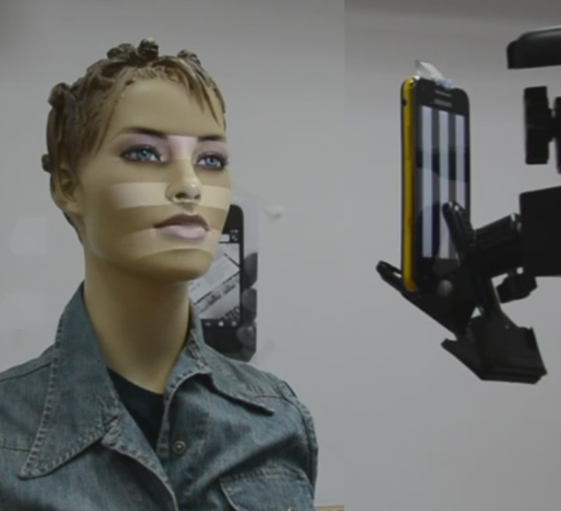

# 3D Scanner on Android

  

A historical student project for structured-light 3D reconstruction using a Samsung Galaxy Beam and a prism to align its projector with the camera's field of view.

Students: Arkadi Godlin, Alex Kligman.

Lab engineer: Alon Zvirin (historical website spelling: Alon Zivrin).

Supervision: Aaron Wetzler.

## Available source

This is a partial historical submission, not a runnable Android release. [`source/`](source/) contains 27 recovered text files: 11 Java files, XML resources, the manifest and the original Eclipse/Android configuration. All 27 files are byte-identical to the recovered originals, as checked with SHA-256.

The capture code projects a sequence of patterns and collects camera frames in NV21/YUV format. [`Reconstructor.java`](source/src/com/project/logic/Reconstructor.java) decodes the projected stripe patterns, corrects camera coordinates using calibration parameters, and computes X, Y and Z arrays. It clears invalid values and median-filters Z, then passes an interleaved coordinate buffer to the OpenGL view, which draws points. Despite the `MeshViewActivity` name, this renderer uses `GL_POINTS`; it does not establish a triangle-mesh export workflow. The reconstruction routine also attempts to write diagnostic BMP images under external storage's `Project/Decode/` directory.

## Setup requirements

The historical application requires a Samsung Galaxy Beam, a prism aligning the projector and camera, calibration data, and an Eclipse/ADT Android project with OpenCV for Android. The manifest sets minimum API 8 and target API 11. `project.properties` references OpenCV Library 2.4.4, while `MainActivity` requests OpenCV Manager 2.4.3. That mismatch remains unresolved.

The launcher is `com.project.activities.MainActivity`. It expects `Project/config.xml` and `Project/calibration_CB_Ex.log` below external storage. A historical build would also need the omitted OpenCV/support libraries and application assets. Calibration and decode data, raw datasets, SDK binaries, APK/class outputs, original Git history and IDE user state are excluded. Project reports are not included.

No verified build command or complete configuration is available. Restoring dependencies alone is insufficient: capture also needs the projector/camera geometry and calibration associated with the physical setup.

## Validation and limitations

A private recovery manifest (not published) records the file-hash comparison for all 27 included files. The documentation review inspected the capture, reconstruction and display paths and their project configuration. No recovered code or binary was compiled or executed, and no successful reconstruction, accuracy measurement or modern Android compatibility is claimed.

## Links

- [Project entry on Aaron Wetzler's website](https://twerdster.github.io/#3d-scanner-on-android)

## Attribution and reuse

No blanket software license has been added. Dependencies retain their own terms. Original authors can open an issue to contribute updates or request corrections or removal of their material.

Figure provenance: `assets/project-preview.jpg` is the original student-project photograph from the archived project page on Aaron Wetzler's website, copied without modification. It shows the capture setup, not a reconstruction produced during recovery.

