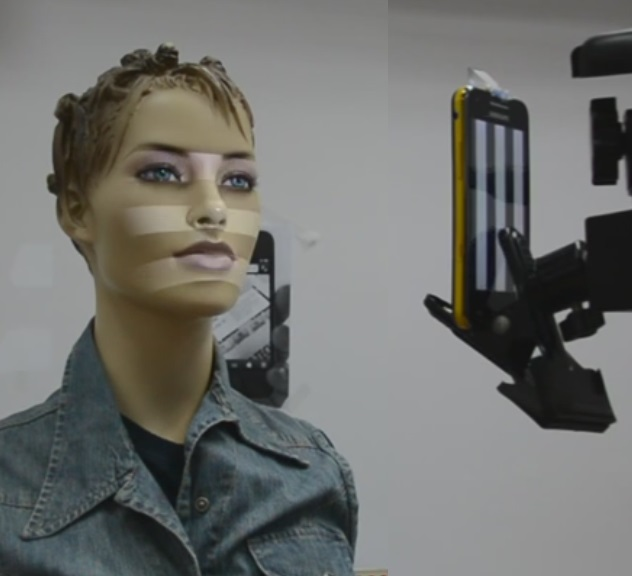

# 3D Scanner on Android

<p align="center">
  
</p>


Historical structured-light 3D reconstruction using a Samsung Galaxy Beam and a prism to align its projector with the camera's field of view. Source, configuration and projection resources from three Android versions are preserved here. These are archival snapshots; a complete application build and hardware capture have not been verified.

Students: Arkadi Godlin, Alex Kligman. Lab engineer: Alon Zvirin (historical website spelling: Alon Zivrin). Supervision: Aaron Wetzler.

## Recovered versions

| Location | Recovered files | Contents |
| --- | ---: | --- |
| [`source/`](source/) | 62 | Submitted Eclipse app: 11 Java files, XML/configuration and 35 pattern/icon images. The original published 27 files remain byte-for-byte unchanged. |
| [`versions/eclipse-2014/`](versions/eclipse-2014/) | 54 | Earlier `com.example.dv1` layout from Git commit `90ee4ef65ec90afa38a4798b6dd9ffaa29efd40d`, dated 23 February 2014; six Java files plus XML/configuration and images. |
| [`versions/android-studio/`](versions/android-studio/) | 63 | Later `com.project` app import: 11 Java files, app resources, Gradle descriptions and wrapper scripts. Dependency modules and the binary wrapper JAR are excluded. |
| [`related/ios-fusion/`](related/ios-fusion/) | 1 source file | Related Objective-C++ renderer fragment, credited in its header to Rom Herskovitz / Technion. Its location in the same backup establishes association only; it is not a restored iOS scanner or an Android version. |

The 180 recovered file instances include repeated files retained in their original version layouts. They are not 180 distinct algorithms or Java classes. Each original file has a byte count, SHA-256 and relative source reference in the [recovery manifest](recovery/manifest.json). Read [version provenance and exclusions](docs/RECOVERY.md) before combining files across versions.

## What the Android code does

The capture interface projects a sequence of stripe patterns and collects camera frames. [`source/src/com/project/logic/Reconstructor.java`](source/src/com/project/logic/Reconstructor.java) decodes those patterns, corrects camera coordinates using calibration parameters, computes XYZ arrays, removes invalid values and median-filters depth. Its interleaved coordinates feed an OpenGL point display: the `MeshViewActivity` name does not establish a triangle-mesh export workflow. Diagnostic BMP writing targets external storage's `Project/Decode/` directory.

The older six-class Eclipse implementation and the later Android Studio import are preserved separately. Studio adds image-buffer handling and `NormalizeDecodedValues`; these historical changes have not been validated as improvements. Each Android version retains 24 synthetic projection BMPs. The submitted/earlier patterns are 360 × 640 pixels; Studio's are 480 × 800. They are projection patterns, not captured scene images or reconstruction results.

## Dependencies and checking

Capture requires the Galaxy Beam/prism geometry and matching camera/projector calibration. The submitted app expects `Project/config.xml` and `Project/calibration_CB_Ex.log` on external storage. OpenCV/support libraries, calibration/capture datasets, raw XYZ arrays, SDK binaries and generated/compiled outputs are excluded. The Eclipse and Studio dependency versions also differ; see [buildability and missing requirements](docs/BUILDABILITY.md).

Run the offline integrity/resource check with Python 3:

```sh
python3 tools/verify_recovery.py
```

[Static-check results](validation/static-checks.json) verify all 180 original hashes, 104 images, 30 XML resource files plus three manifests, Android activity classes and local Java resource references. Five pure-Java helper file instances also [compile with OpenJDK 21](validation/java-helpers.json). These checks do not build an APK, link OpenCV, exercise the camera/projector or measure reconstruction accuracy. No modern Android compatibility or runnable historical release is claimed.

## Attribution and reuse

No blanket software license has been added. Retain the original notices and third-party terms. The `Quaternion` implementation includes an attribution to the Bones framework for JPCT; it remains in the source. The related iOS renderer retains its 2014 Technion copyright and “All rights reserved” notice. Launcher graphics and projection resources are preserved from the historical snapshots; their inclusion does not assign new rights.

On 2026-11-12, Alex Kligman agreed to Aaron Wetzler keeping the archival project page and repository. This records Alex Kligman's response only; no software license is added. The recovered subset and historical hardware/dependency limitations are unchanged.

That dated record describes the earlier snapshot; it does not extend the correspondence to the additional versions recovered on 14 November 2026.

Original authors can open an issue to contribute updates or request corrections or removal of their material. [Project entry on Aaron Wetzler's website](https://twerdster.github.io/#3d-scanner-on-android).

Figure provenance: `assets/project-preview.jpg` is the original student-project photograph from the archived project page on Aaron Wetzler's website, copied without modification. It shows the capture setup, not a reconstruction produced during recovery.
