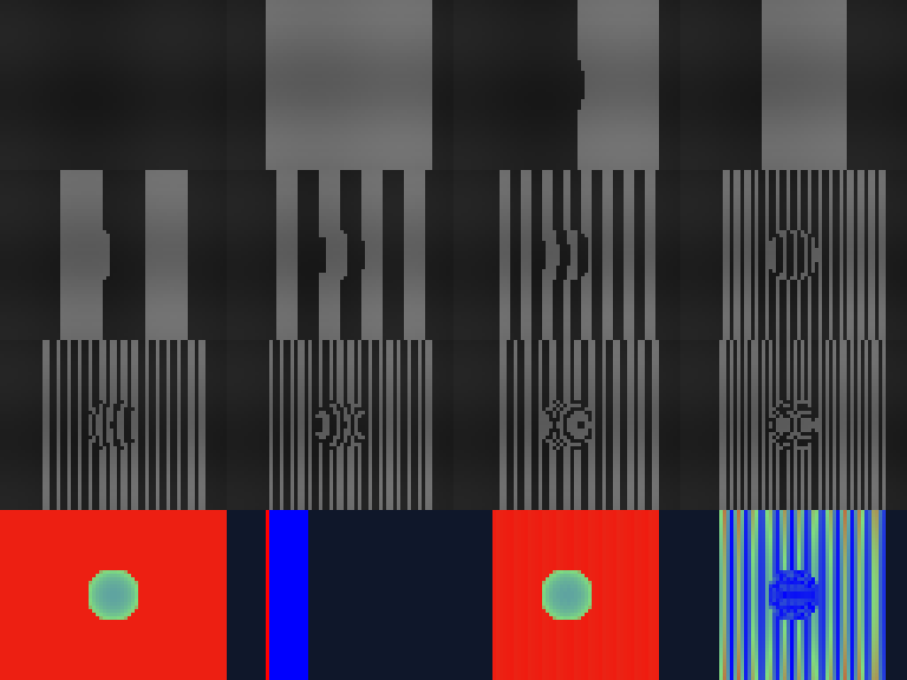

# 3D Scanner on Android

<p align="center">
  
</p>


Structured-light 3D reconstruction using a Samsung Galaxy Beam and a prism to align its projector with the camera's field of view. The scanner projects Gray-coded stripes, matches camera pixels to projector addresses and triangulates 3D points using camera/projector calibration.

This repository preserves three historical Android versions and now includes a runnable desktop and Android **synthetic capture replay**. The replay executes recovered scanning calculations on independently generated surfaces with known geometry. The original historical APK remains blocked by missing build dependencies; physical camera/projector capture has not been reproduced.

Students: Arkadi Godlin, Alex Kligman. Lab engineer: Alon Zvirin (historical website spelling: Alon Zivrin). Supervision: Aaron Wetzler.

## Run the reconstruction

Python 3.10+ and a local JDK (`java` and `javac`) are enough for the desktop path; no Python packages or Android SDK are needed:

```sh
python3 updated/run_checks.py
python3 -m updated.cli simulate --output updated/results
```

Open [the interactive report](updated/results/index.html) to inspect captured stripes, ground-truth/reconstructed depth, 3D error and rotatable point clouds. [PLY point clouds](updated/results/sphere.ply), [metrics](updated/results/metrics.json) and a [CSV table](updated/results/metrics.csv) are included. The [new Android replay app](updated/android-replay/README.md) displays the same captures and calculations on-device. See the [replay quickstart and method scope](updated/README.md).



First three rows show the twelve generated captures. The last row shows truth depth, unchanged historical numerical output, corrected depth and corrected error. These are new synthetic results, separate from the physical setup photograph above.

## Synthetic results

The replay runs the **unchanged submitted Java numerical methods** in a desktop harness and compares them with a separately labeled correction. Camera rays intersect planes, a sphere, a depth step and an opaque box; forward projection and visibility tests generate their captured stripe images. Thirteen scenes include transformed calibration, nonlinear radial distortion, shadows, noise, high/low contrast, corrupt bits and degenerate geometry.

| Geometric scene | Corrected 3D RMSE | Illuminated points retained |
| --- | ---: | ---: |
| Front plane at 0.72 m | 3.18 mm | 100% |
| Tilted plane | 3.45 mm | 100% |
| Sphere with background | 5.39 mm | 100% |
| Rotated/translated camera and projector | 3.89 mm | 100% |
| Nonlinear radial correction, offset center and aspect | 3.66 mm | 100% |

These results use virtual calibration, a 64 × 48 camera and ten-bit projector addresses; stripe quantization contributes to the error. The shadow test accepts no unilluminated points, while low contrast and zero baseline yield no valid depth. The unchanged submitted decoder exposes signed-byte overflow and a fourfold scaling discrepancy between twelve captures and ten decoded bits; Studio's different defaults are separately documented. Corrupted stripe bits can still produce large outliers in the corrected path; this is not an error-correcting decoder.

Both numerical comparisons stop before historical coordinate clipping and OpenCV median filtering. The tests do not measure hardware accuracy, calibration estimation or inter-frame motion. [Model, findings and full conditions](docs/SIMULATION.md), [13-test results](validation/numerical-tests.json) and [historical build diagnostics](validation/historical-build-attempt.json) keep those scopes explicit.

The new Android app also ran on an Android 14 ARM64 emulator. Independent comparison covered **80,098 pixel records** with exact validity masks; scene/mode switching, point-cloud rotation, capture browsing and repeatable Replay passed [runtime and UI checks](validation/android-ui.json). See [pixel parity evidence](validation/android-independent-parity.json) for numerical bounds.

## Recovered versions

| Location | Recovered files | Contents |
| --- | ---: | --- |
| [`source/`](source/) | 62 | Submitted Eclipse app: 11 Java files, XML/configuration and 35 pattern/icon images. The original published 27 files remain byte-for-byte unchanged. |
| [`versions/eclipse-2014/`](versions/eclipse-2014/) | 54 | Earlier `com.example.dv1` layout from Git commit `90ee4ef65ec90afa38a4798b6dd9ffaa29efd40d`, dated 23 February 2014; six Java files plus XML/configuration and images. |
| [`versions/android-studio/`](versions/android-studio/) | 63 | Later `com.project` app import: 11 Java files, app resources, Gradle descriptions and wrapper scripts. Dependency modules and the binary wrapper JAR are excluded. |
| [`related/ios-fusion/`](related/ios-fusion/) | 1 source file | Related Objective-C++ renderer fragment, credited in its header to Rom Herskovitz / Technion. Its location in the same backup establishes association only; it is not a restored iOS scanner or an Android version. |

The 180 recovered file instances include repeated files retained in their original version layouts. They are not 180 distinct algorithms or Java classes. Each original file has a byte count, SHA-256 and relative source reference in the [recovery manifest](recovery/manifest.json). Read [version provenance and exclusions](docs/RECOVERY.md) before combining files across versions.

## What the Android code does

The capture interface projects a sequence of stripe patterns and collects camera frames. [`source/src/com/project/logic/Reconstructor.java`](source/src/com/project/logic/Reconstructor.java) decodes those patterns, corrects camera coordinates using calibration parameters, computes XYZ arrays, removes invalid values and median-filters depth. Its interleaved coordinates feed an OpenGL point display: the `MeshViewActivity` name does not establish a triangle-mesh export workflow. Diagnostic BMP writing targets external storage's `Project/Decode/` directory.

The older six-class Eclipse implementation and the later Android Studio import are preserved separately. Studio changes image-buffer handling and default dimensions; normalization is present in both submitted and Studio versions. These historical changes are not asserted improvements. Each Android version retains 24 synthetic projection BMPs. The submitted/earlier patterns are 360 × 640 pixels; Studio's are 480 × 800. They are projection patterns, not captured scene images or reconstruction results.

## Dependencies and checking

Capture requires the Galaxy Beam/prism geometry and matching camera/projector calibration. The submitted app expects `Project/config.xml` and `Project/calibration_CB_Ex.log` on external storage. OpenCV/support libraries, calibration/capture datasets, raw XYZ arrays, SDK binaries and generated/compiled outputs are excluded. The Eclipse and Studio dependency versions also differ; see [buildability and missing requirements](docs/BUILDABILITY.md).

Run the offline integrity/resource check with Python 3:

```sh
python3 tools/verify_recovery.py
```

[Static-check results](validation/static-checks.json) verify all 180 original hashes, 104 images, 30 XML resource files plus three manifests, Android activity classes and local Java resource references. Five pure-Java helper file instances also [compile with OpenJDK 21](validation/java-helpers.json). Later [build attempts with Android API 35](validation/historical-build-attempt.json) still fail on missing OpenCV/build inputs. The new numerical replay and Android application are separately labeled and tested; neither establishes a runnable historical release or camera/projector accuracy.

## Attribution and reuse

No blanket software license has been added. Retain the original notices and third-party terms. The `Quaternion` implementation includes an attribution to the Bones framework for JPCT; it remains in the source. The related iOS renderer retains its 2014 Technion copyright and “All rights reserved” notice. Launcher graphics and projection resources are preserved from the historical snapshots; their inclusion does not assign new rights.

On 2026-11-12, Alex Kligman agreed to Aaron Wetzler keeping the archival project page and repository. This records Alex Kligman's response only; no software license is added. The recovered subset and historical hardware/dependency limitations are unchanged.

That dated record describes the earlier snapshot; it does not extend the correspondence to the additional versions recovered on 14 November 2026.

Original authors can open an issue to contribute updates or request corrections or removal of their material. [Project entry on Aaron Wetzler's website](https://twerdster.github.io/#3d-scanner-on-android).

Figure provenance: `assets/project-preview.jpg` is the original student-project photograph from the archived project page on Aaron Wetzler's website, copied without modification. It shows the capture setup, not a reconstruction produced during recovery.
