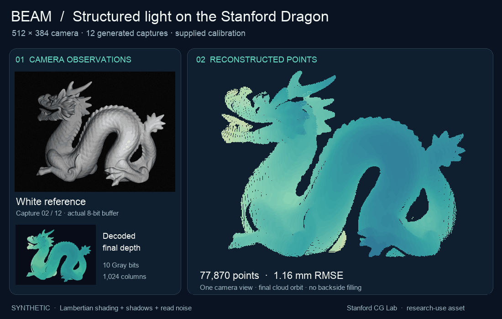

# Dense structured-light reconstruction of the Stanford Dragon

Twelve generated **512 × 384** camera exposures encode a detailed, 0.35-metre-tall Dragon. The existing corrected Beam decoder recovers projector addresses and triangulates **77,870 points** from those images and supplied calibration. The source mesh never enters the decoder or animation renderer.



| Result | Value |
| --- | ---: |
| Camera surface pixels | 79,082 |
| Illuminated surface pixels | 78,200 |
| Accepted / scored points | 77,870 |
| Illuminated coverage | 99.578% |
| 3D correspondence RMSE | 1.158 mm |
| 95th-percentile / maximum error | 1.943 / 2.828 mm |
| Projector-shadow pixels | 880 |
| Accepted background / unilluminated pixels | 0 / 0 |

Errors compare each accepted point with the **first mesh intersection of that camera pixel**, rather than the nearest convenient surface. The additional nearest-mesh RMSE is 0.870 mm. Coverage includes every geometrically illuminated surface pixel, including dim/grazing samples rejected for insufficient contrast. All accepted projector integer addresses are correct in this run. [Complete metrics and hashes](results/metrics.json).

## Inspect the data

- [White exposure](results/captures/01.png), [coded exposure](results/captures/06.png), [all twelve captures](results/captures/), [decoded depth](results/depth.png) and [geometric projector-shadow mask](results/shadow-mask.png).
- [Reconstructed PLY](results/dragon-reconstruction.ply) contains the actual accepted XYZ points, without mesh vertices, filling or smoothing.
- [Observations](results/observations.npz) contain only unsigned capture buffers and calibration. [Reconstruction](results/reconstruction.npz) stores XYZ, valid mask and decoded address. [Evaluation](results/evaluation.npz) separately stores scoring truth and visibility. All NPZ arrays load with `allow_pickle=False`.
- [Rig](results/rig.json), [source mesh provenance](mesh-provenance.json), [observation-only replay checks](test-results.json), [forward-raycaster checks](raycast-validation.json), [mesh-reproduction checks](asset-reproduction-validation.json) and [GIF frame validation](media-validation.json).

## Reproduce

Python **3.12** was tested with NumPy **2.0.2**, Open3D **0.18.0** and Pillow **10.4.0**. Use a local environment; no JDK or Android SDK is needed for this showcase:

```sh
python3.12 -m venv .venv-showcase
.venv-showcase/bin/python -m pip install -r showcase/requirements.txt
.venv-showcase/bin/python showcase/check_showcase.py
```

The five checks replay the committed captures before loading truth, reproduce every saved XYZ/address/validity mask, independently recompute errors and coverage, check camera/projector constraints, exercise geometric-shadow radiometry and verify all bound media frames. They need NumPy and Pillow; Open3D is required only to generate new observations.

To rebuild from the source geometry, first read [Stanford’s asset terms](STANFORD-ASSET-TERMS.md). Keep downloaded/normalized meshes and full-resolution PNG-frame scratch outside Git:

```sh
.venv-showcase/bin/python showcase/prepare_mesh.py --download --output /path/to/mesh-cache
.venv-showcase/bin/python showcase/build_showcase.py \
  --mesh /path/to/mesh-cache/dragon-normalized.npz --scratch /path/to/beam-scratch
.venv-showcase/bin/python showcase/render_gif.py --scratch /path/to/beam-gif-frames
.venv-showcase/bin/python showcase/check_showcase.py
```

The explicit download fetches the approximately 11.2 MB official archive. The recipe verifies pinned archive/member SHA-256 values and reads selected members without arbitrary extraction. `--archive /path/to/dragon_recon.tar.gz` supports offline preparation. Only translation and uniform scale are applied; no axis rotation, decimation, repair or hole filling. The builder rejects a mesh whose normalized hash differs. The shared source recipe was independently reproduced byte-for-byte.

## What this experiment models

Independent Open3D first-hit camera rays intersect all **871,414 triangles**. Projector forward projection determines ten-bit Gray addresses; a second mesh query tests open-segment visibility from the projector. The virtual camera and projector have a 0.12-metre baseline and explicit toe-in calibration. Lambertian direct illumination, inverse-square falloff, spatial reflectance, ambient light and 0.8-level Gaussian read noise create twelve actual 8-bit buffers. Two-sided source-triangle normals are oriented toward the observing camera before illumination, including scan-hole/back-facing boundaries. The official reconstructed mesh has small holes; they remain unfilled.

`build_showcase.py` passes **only frames and calibration** to unchanged `updated.synthetic.decode_corrected`. Mesh points, normals, projector addresses and masks stay in the forward generator/evaluator. The same existing unsigned Gray decode, normalization, radial mapping and guarded triangulation run before historical clipping/median stages. There is no error-correcting code or hidden outlier removal.

This is **one camera view**, not a complete 360° scan. The GIF orbits its final cloud by ±28°; no unseen backside is inferred. It shows the recorded exposures alongside final depth/cloud, without suggesting a partial sequence can already reconstruct everything. Depth colors use reconstructed points only; 2×2 display splats do not change geometry. All 96 decoded RGB frames were verified; the 1100 × 700 loop lasts 9.6 seconds and is 3.63 MB. Regeneration searches for Arial/DejaVu, or accepts `--font`; font and input/output hashes are recorded.

Calibration estimation, motion, optical blur and interreflection are unmodelled. These virtual-metre results do not establish physical-phone accuracy or restore the historical APK. The [thirteen smaller regression scenes](../updated/README.md) remain separate and unchanged.

## Credit and terms

The Stanford University Computer Graphics Laboratory supplies the Dragon, associated with Brian Curless and Marc Levoy’s SIGGRAPH 1996 volumetric reconstruction work. [Source and terms](STANFORD-ASSET-TERMS.md) permit research/free redistribution with acknowledgement and require permission for commercial use. The mesh, its derived observations/images/clouds and animation are **not** included in an unrestricted software license. All newly authored Python code in this showcase has the [scoped MIT grant](HELPER-LICENSE), including the observation generator, replay checks and renderer. Original student code, third-party dependencies and notices retain their existing status.
