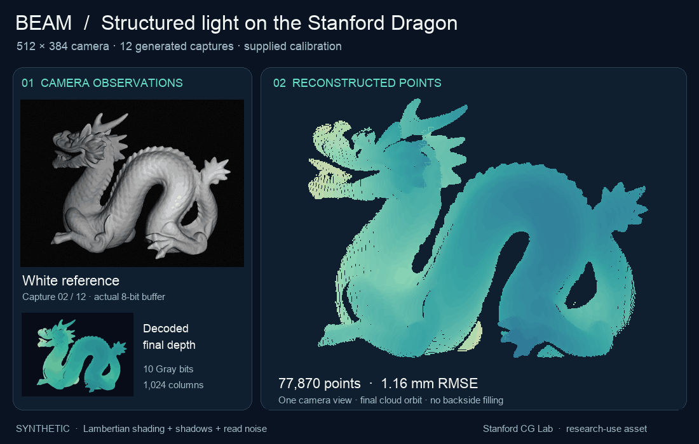

# 3D Scanner on Android — updated work

<a id="updated-and-ported-for-modern-hardware"></a>

## Updated work

The browser viewer rotates the saved decoded Dragon points and links the 13-scene interactive capture/output report. It does not execute reconstruction. All displayed scanner results are synthetic with supplied calibration, the original Android app remains blocked by missing dependencies, and no physical device accuracy is established.

**[Run the browser demo](https://twerdster.github.io/android-3d-scanner/)** · [Browser demo source and local use](../demo/README.md)



## Run locally

The static demo was checked in current Chrome and needs no package installation. From the repository root:

```sh
python3 -m http.server 8000 --directory demo
```

Open http://localhost:8000. The browser displays saved reconstruction output; it does not execute reconstruction.

## Reconstruction implementation

The unchanged original Java calculations run headless alongside a corrected Python path on 13 simulated scenes. A new Android replay app ran those fixtures on an emulator. The dense Dragon replay decodes 12 synthetic 512×384 exposures with supplied calibration. It produced 77,870 accepted points, 1.158 mm virtual correspondence RMSE and 99.578% illuminated coverage. Physical hardware accuracy has not been measured, and the original APK still does not build ([details](../docs/BUILDABILITY.md)). Test records are in [validation/](../validation/).

Requirements: Python 3.10+ and a JDK for the desktop regressions. The dense replay also needs NumPy and Pillow (`python3 showcase/check_showcase.py`). See the [detailed implementation, setup and validation guide](DETAILS.md).


[Previous archive README](../ORIGINAL_PROJECT_REFERENCE.md) · [Detailed conversion and validation notes](DETAILS.md) · [Browser data provenance](../demo/provenance.json).
